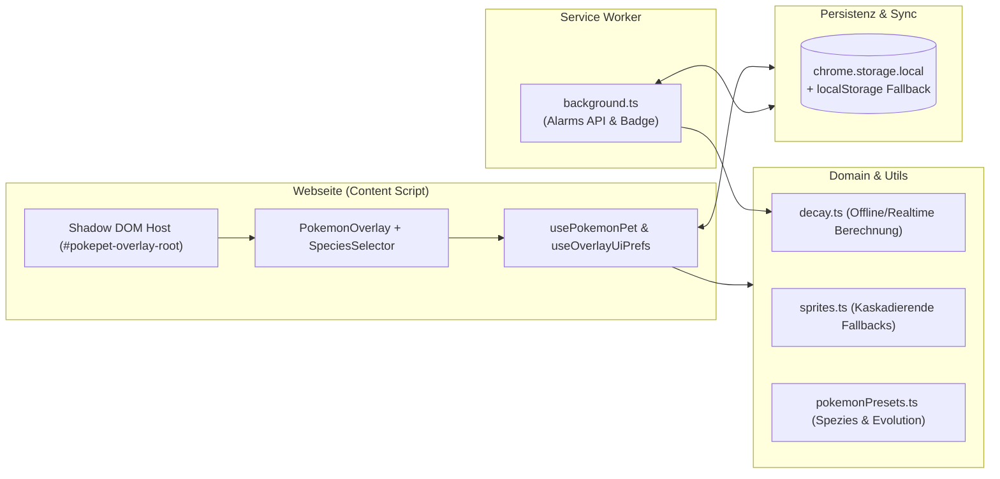

# Systemarchitektur

## Kernkomponenten

| Datei | Verantwortung |
| :--- | :--- |
| `src/types/pokemon.ts` | Strikt typisierte Datenmodelle (`PokemonState`, `PokemonNeeds`, `PokemonSpecies`, `DecayConfig`, `PetMood`). |
| `src/constants/pokemonPresets.ts` | 10 vordefinierte Pokémon-Presets, Decay-Raten und mehrstufige Evolutionsregeln (`checkEvolution`). |
| `src/utils/decay.ts` | Reine Funktionen (*Pure Functions*) für Zeitdifferenz-Berechnung (`calculateDecayedState`) und Stimmungsanalyse (`determineMood`). |
| `src/utils/sprites.ts` | Generiert eine Fallback-Hierarchie für animierte GIFs (PokémonDB, Showdown, PokeAPI) bis hin zu einem Offline-SVG-Pokéball. |
| `src/utils/storage.ts` | Abstraktionsschicht über `browser.storage.local` / `chrome.storage.local` mit `localStorage`-Fallback und Event-Subscription. |
| `src/hooks/usePokemonPet.ts` | Zentraler State- & Action-Hook (`feed`, `play`, `pet`, `toggleSleep`, `changeSpecies`, `setCustomNickname`, Level-Up & Evolution). |
| `src/components/PokemonOverlay.tsx` | Draggable Widget, Smart-Panel-Positionierung, Inline-Rename und Statusbalken. |
| `src/components/SpeciesSelector.tsx` | Modal zur Auswahl von Presets oder beliebigen Pokémon per Name/ID inklusive Live-Validierung über die **PokeAPI**. |
| `entrypoints/content/index.tsx` | Injektion des **Shadow DOM** Containers zur vollständigen CSS- und Event-Isolation von der Host-Webseite. |
| `entrypoints/background.ts` | Hintergrund-Synchronisation via `browser.alarms` (alle 5 Min.), Toolbar-Toggle und Warn-Badge (`!`), wenn Werte $\le 15\%$ fallen. |
